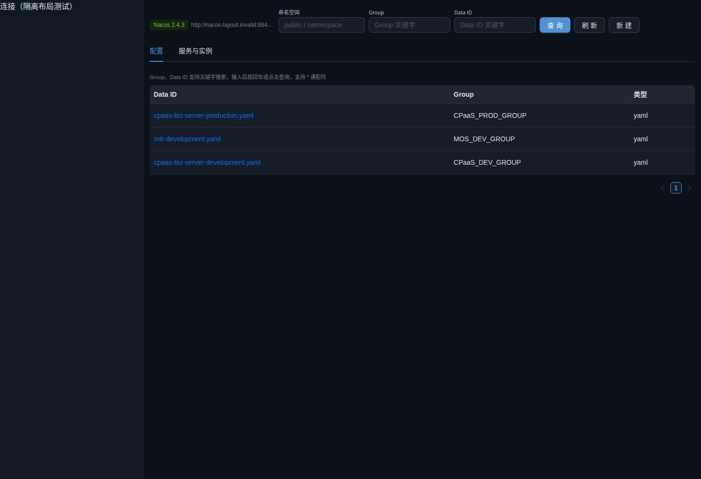

# OpsPier

OpsPier 1.0.0 是一个桌面运维工作台，集中管理远程终端、数据库、Kubernetes 集群、Nacos 配置与注册信息和 MinIO 对象存储。

## 技术栈

- 桌面框架：Tauri 2、Rust。
- 界面：React 19、TypeScript、Ant Design 6、Vite。
- 终端：xterm.js、SSH2、portable-pty。
- 数据库：SQLx、SQLParser。
- Kubernetes：kube-rs、k8s-openapi。
- 对象存储：MinIO Rust SDK。
- 凭据保存：操作系统安全凭据库，目前支持 Linux Secret Service。

## 已有功能

- 连接分类管理、连接测试和状态展示；连接列表及各分类支持独立收起与展开。
- SSH 密码及私钥认证、主机指纹校验、终端分屏和复制粘贴。
- MySQL / Apache Doris 库表浏览、字段与索引查看、只读 SQL、分页、查询取消和 CSV 导出。新建连接自动协商 TLS，默认数据库可选。
- Kubernetes 配置文件导入及粘贴、Context 和命名空间选择、资源搜索、后台刷新、CRD、YAML 和 Pod 日志查看。
- Kubernetes 本地 kubectl 交互终端：需要本机已有 kubectl，Linux 使用无用户启动脚本的 bash；支持 logs -f、watch、exec -it、Ctrl+C、resize、Tab 与会话内历史。资源与终端视图切换保留进程；Context 切换结束旧终端并需重新打开。
- 终端只导出当前 Context 及其引用的认证材料到私有 kubeconfig，不读取或修改用户默认集群。命名空间为空时采用 kubectl 的 default；`-A` 和其他显式参数由用户输入。命令按凭据 RBAC 执行；数据库和图形资源浏览仍只读。终端输入输出不写入诊断历史，私有文件在退出后清理。
- Nacos 2.x 匿名或账号密码连接、命名空间/Group 查询、配置新建发布删除、历史对照与回滚；服务属性及实例启停、权重、元数据维护。写入需确认，防陈旧预检并读回核验；不确定结果不自动重发。实例元数据按服务端覆盖合并语义支持新增、修改，保留现有键；已有配置发布使用服务端 CAS；新建、删除及服务/实例 API 仅能写前预检，预检后的并发变更仍需人工协调。
- MinIO 桶与对象浏览、分页、文件选择及拖入上传、下载和单对象删除；同名覆盖与删除前确认。
- 使用系统凭据库保存密码和认证材料，重开连接时无需重复输入。

## 界面示例

下面的截图来自隔离测试数据，仅用于展示界面布局，不包含生产地址、账号或凭据。

## 1.0.0 发布内容

- 增加 Nacos 2.x 配置、服务和实例管理。
- 增加 Kubernetes 交互终端，并保留 Context、命名空间和会话隔离。
- 增加格式化工具和 HTTP 请求调试工具。
- 增加 Linux x86_64 AppImage、Debian 包和 SHA256 校验文件的 GitHub Actions 发布流程。

## 计划功能

- Windows 完整安装包与实机兼容性验证。
- Windows 兼容适配及安全凭据保存。
- 增加 Oracle、SQL Server、SQLite 和 Elasticsearch 支持。
- 增加 RustFS、NFS 等存储服务管理。
- 持续完善连接诊断、资源检索和工作区交互。
